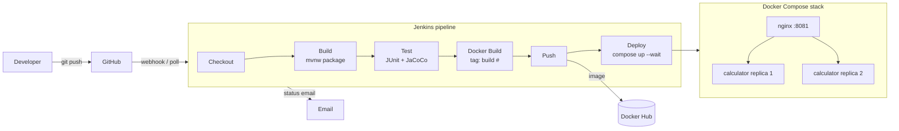

# Calculator DevOps — CI/CD Pipeline for a Calculator REST API

CSE 816 Software Production Engineering — Mini-Project

A small Spring Boot calculator API wrapped in a fully automated DevOps pipeline:
a push to GitHub triggers Jenkins, which builds, tests, containerizes, publishes
the image to Docker Hub, and deploys the stack with Docker Compose. No manual steps.

**Stack:** Java 21 · Spring Boot 3.5 · Maven · JUnit 5 · Git/GitHub · Jenkins · Docker · Docker Compose · nginx

---

## Architecture



The deployed stack runs two replicas of the API behind an nginx reverse proxy that
load-balances between them. Only nginx is published on the host (port **8081**,
since Jenkins already uses 8080).

---

## API

| Operation | Endpoint                       | Behaviour                                  |
|-----------|--------------------------------|--------------------------------------------|
| Add       | `GET /api/v1/add?a=&b=`        | Returns `a + b`                            |
| Subtract  | `GET /api/v1/subtract?a=&b=`   | Returns `a - b`                            |
| Multiply  | `GET /api/v1/multiply?a=&b=`   | Returns `a * b`                            |
| Divide    | `GET /api/v1/divide?a=&b=`     | Returns `a / b`; `b=0` → HTTP 400          |
| Health    | `GET /actuator/health`         | Spring Actuator health probe (UP/DOWN)     |

```console
$ curl "http://localhost:8081/api/v1/add?a=2&b=3"
{"operation":"add","a":2,"b":3,"result":5}

$ curl "http://localhost:8081/api/v1/add?a=0.1&b=0.2"
{"operation":"add","a":0.1,"b":0.2,"result":0.3}

$ curl "http://localhost:8081/api/v1/divide?a=10&b=0"
{"timestamp":"2026-10-28T04:25:52.085Z","status":400,"error":"Bad Request","message":"Division by zero is not allowed","path":"/api/v1/divide"}
```

Every invalid request returns HTTP 400 with the same error body:

| Request                       | `message`                                   |
|-------------------------------|---------------------------------------------|
| `/divide?a=10&b=0`            | `Division by zero is not allowed`           |
| `/add?a=2` (missing `b`)      | `Missing required parameter 'b'`            |
| `/add?a=two&b=3`              | `Parameter 'a' must be a number, got 'two'` |
| `/add?a=NaN&b=1`, `Infinity`  | `Parameter 'a' must be a finite number`     |

Arithmetic is done with `BigDecimal` (16 significant digits), so results like
`0.1 + 0.2` come out as `0.3`, not the floating-point `0.30000000000000004`.

---

## Running locally

Only a JDK 21 is needed for the app; the Maven wrapper (`./mvnw`) downloads Maven itself.

```bash
./mvnw test                       # unit + integration tests, JaCoCo coverage report
./mvnw clean package              # build target/calculator-devops.jar
java -jar target/calculator-devops.jar        # http://localhost:8080
```

Test reports: `target/surefire-reports/` (JUnit XML) and `target/site/jacoco/index.html` (coverage).
The build fails if line coverage drops below 80%.

### Docker

```bash
docker build -t calculator-devops .
docker run --rm -p 8080:8080 calculator-devops
```

### Docker Compose (full stack)

```bash
docker compose up -d --build      # 2 API replicas + nginx
docker compose ps                 # all three should be (healthy)
curl "http://localhost:8081/api/v1/multiply?a=6&b=7"
curl -i "http://localhost:8081/api/v1/add?a=1&b=1"   # X-Served-By header shows which replica answered
docker compose down
```

---

## CI/CD pipeline (Jenkins)

Defined in [`Jenkinsfile`](Jenkinsfile) as a declarative pipeline.

| Stage        | What it does                                                                                |
|--------------|---------------------------------------------------------------------------------------------|
| Checkout     | Pulls the commit that triggered the build                                                   |
| Build        | `./mvnw clean package -DskipTests`                                                          |
| Test         | `./mvnw test`; publishes JUnit results and the JaCoCo report; any failure fails the build   |
| Docker Build | Builds the image tagged `calculator-devops:<build number>` and `:latest`                    |
| Push         | Logs in with Jenkins-stored credentials and pushes `<dockerhub-user>/calculator-devops:<build number>` and `:latest` |
| Deploy       | `docker compose up -d --wait` (blocks until health checks pass), then a smoke test through nginx |

After every run, Jenkins emails the build status (with the console log attached on failure).

**Re-runnable and idempotent:** Compose only recreates containers whose image or
configuration changed, so re-running the same build leaves the running stack alone,
and a new build replaces the replicas with the new image. `disableConcurrentBuilds()`
stops two deployments from racing.

### Jenkins setup

1. **Plugins** (Manage Jenkins → Plugins): Git, GitHub, Pipeline, JUnit, Credentials Binding,
   Email Extension, HTML Publisher, Timestamper.
2. **Docker Hub credentials** (Manage Jenkins → Credentials → System → Global → Add):
   kind *Username with password*, ID **`dockerhub-credentials`**, username = your Docker Hub
   username, password = a Docker Hub [access token](https://app.docker.com/settings/personal-access-tokens)
   (Read & Write). The image is pushed under that username, so nothing is hard-coded in the repo.
3. **Email** (Manage Jenkins → System → *Extended E-mail Notification*): SMTP server
   `smtp.gmail.com`, port 587, TLS, with a Gmail [app password](https://myaccount.google.com/apppasswords).
   The recipient is `NOTIFY_EMAIL` in the Jenkinsfile.
4. **Job**: New Item → *Pipeline* → Pipeline script from SCM → Git →
   `https://github.com/InvincibleAgam/SPE-Mini-Project.git`, branch `*/main`, script path `Jenkinsfile`.
   Tick *GitHub hook trigger for GITScm polling*. Run it once manually so Jenkins registers the triggers.
5. **Webhook**: GitHub repo → Settings → Webhooks → Add webhook, payload URL
   `https://<public-jenkins-url>/github-webhook/`, content type `application/json`, *just the push event*.
   Jenkins on `localhost` is not reachable from GitHub, so expose it with a tunnel such as
   `ngrok http 8080` and use that URL. If the webhook isn't set up, the pipeline's `pollSCM`
   trigger still picks up pushes within about 2 minutes.

> **macOS note:** Homebrew's Jenkins runs under launchd with a minimal `PATH` that does not
> include `/usr/local/bin`, where Docker Desktop installs `docker`. The Jenkinsfile prepends it.
> Docker Desktop must be running for the Docker stages.

---

## Repository structure

```
.
├── src/main/java/com/spe/calculator/
│   ├── CalculatorApplication.java
│   ├── controller/CalculatorController.java     # REST endpoints
│   ├── service/CalculatorService.java           # arithmetic + input validation
│   ├── model/                                   # CalculationResult, ApiError (JSON bodies)
│   └── exception/                               # custom exceptions + GlobalExceptionHandler (HTTP 400)
├── src/main/resources/application.yml
├── src/test/java/com/spe/calculator/
│   ├── service/CalculatorServiceTest.java       # JUnit 5 unit tests
│   └── controller/CalculatorControllerIntegrationTest.java   # MockMvc integration tests
├── pom.xml, mvnw, .mvn/                         # Maven build + wrapper
├── Dockerfile, .dockerignore                    # multi-stage image (JDK build → JRE runtime)
├── docker-compose.yml                           # 2 API replicas + nginx, network, health checks
├── nginx/                                       # reverse proxy image + config
├── Jenkinsfile                                  # declarative CI/CD pipeline
└── README.md
```

## Design notes

- **Multi-stage Dockerfile:** a Maven/JDK stage builds the JAR; the runtime stage is
  `eclipse-temurin:21-jre-alpine` with only the JAR, running as a non-root `spring` user.
  `pom.xml` is copied and dependencies are downloaded before the source, so code changes
  reuse the cached dependency layer. `.dockerignore` is an allow-list (`pom.xml`, `src/` only).
- **nginx and redeploys:** nginx re-resolves the `calculator` service name through Docker's DNS
  every 5 s. Without this it would keep the IPs it saw at startup and return 502 after
  every redeploy, because the new containers get new IPs.
- **Docker Hub login in Jenkins:** the Push stage logs in using a temporary Docker config
  directory that is deleted afterwards, so the pipeline's credentials never mix with (or log out)
  the agent machine's own Docker login.
- **Secrets:** no credentials live in the repository; Docker Hub and SMTP credentials are stored in Jenkins.

## Git workflow

Work happens on feature branches (`feature/calculator-api`, `feature/containerization`,
`feature/jenkins-pipeline`) that are merged into `main` with merge commits, so each
feature's history stays visible. `main` always builds.
